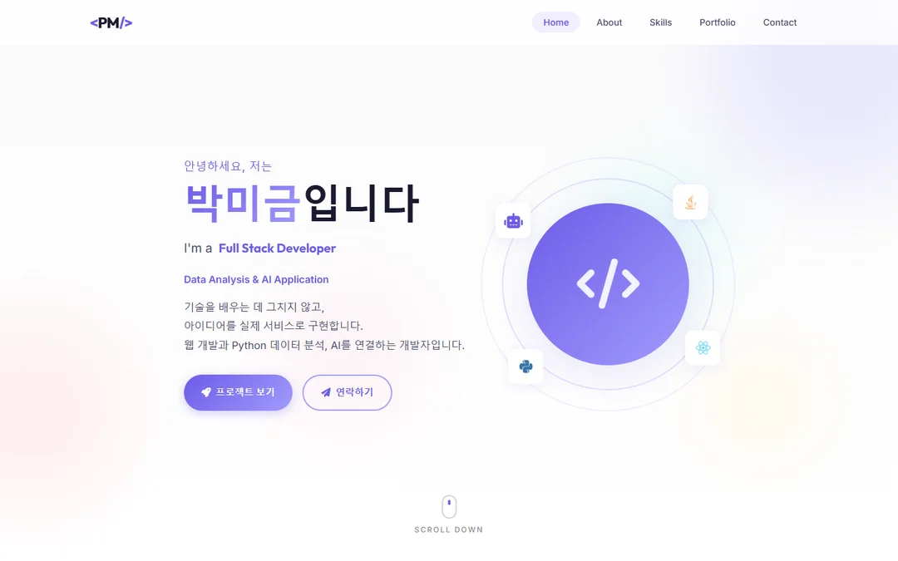

<div align="center">

<h1>박미금 | Developer Portfolio</h1>

<p><strong>Full Stack Developer · Data Analysis &amp; AI Application</strong></p>
<p>기술을 배우는 데 그치지 않고, 아이디어를 실제 서비스로 구현합니다.</p>

<p>
  <a href="https://developer.mozilla.org/ko/docs/Web/HTML"></a>
  <a href="https://developer.mozilla.org/ko/docs/Web/CSS"></a>
  <a href="https://developer.mozilla.org/ko/docs/Web/JavaScript"></a>
</p>
<p>
  <a href="https://fsclass-n.github.io/parkmigeum/"></a>
  <a href="https://parkmigeum.netlify.app/"></a>
  <a href="https://web3forms.com/"></a>
</p>
<p>
  <a href="#license"></a>
  <a href="https://github.com/fsclass-n/parkmigeum/issues"></a>
  <a href="https://github.com/fsclass-n/parkmigeum"></a>
  <a href="https://github.com/fsclass-n/parkmigeum/commits/main/"></a>
</p>

<p>
  <a href="https://fsclass-n.github.io/parkmigeum/"><strong>GitHub Pages 바로가기</strong></a>
  · <a href="https://parkmigeum.netlify.app/"><strong>Netlify 바로가기</strong></a>
  · <a href="https://github.com/fsclass-n/parkmigeum/issues">이슈 등록</a>
</p>

</div>

## 프로젝트 소개

웹 개발·데이터 분석·AI 활용 역량과 프로젝트 경험을 소개하는 박미금의 개인 포트폴리오입니다.
HTML, CSS, JavaScript로 제작했으며, 밝은 배경과 보라색 포인트를 사용한 반응형 화면과
Web3Forms 기반 이메일 문의 폼을 제공합니다.



## 배포 주소

| 배포 환경 | 접속 주소 | 배포 구성 |
| --- | --- | --- |
| GitHub Pages | **https://fsclass-n.github.io/parkmigeum/** | `main` 브랜치의 루트(`/`)에서 정적 사이트 제공 |
| Netlify | https://parkmigeum.netlify.app/ | `netlify.toml`의 `publish = "."` 설정 사용 |

별도의 빌드 과정 없이 HTML·CSS·JavaScript 파일을 직접 제공하는 정적 사이트입니다.

## Features

- Home → About(교육·개발 철학 포함) → Skills → Portfolio → Contact 원페이지 구성
- PC·태블릿·모바일 대응 반응형 레이아웃
- 고정 내비게이션, 타이핑·스크롤 애니메이션, 스크롤 진행 표시, TOP 버튼
- 실제 배포 서비스와 GitHub 프로젝트 소개 링크 분리
- `tel:`, `mailto:` 연락 링크 및 SEO·Open Graph 메타데이터
- 기존 Web3Forms 설정을 사용하는 이메일 문의 폼(이름·제목·이메일·전화번호·메시지)

## Tech Stack

| 기술 | 활용 |
| --- | --- |
| HTML5 | 시맨틱 페이지 구조, 프로젝트 콘텐츠, 문의 폼 |
| CSS3 | 반응형 레이아웃, 카드 디자인, 애니메이션 |
| Vanilla JavaScript | 메뉴·스크롤 인터랙션, 폼 검증·비동기 전송 |
| Web3Forms | 별도 백엔드 없이 이메일 문의 접수 |
| GitHub Pages · Netlify | 정적 사이트 배포 |

## Verification

정적 사이트이므로 별도 빌드 과정이 없습니다. 로컬에서는 다음 명령으로 확인할 수 있습니다.

```bash
python -m http.server 8000
```

브라우저에서 `http://localhost:8000` 접속 후 내비게이션, 프로젝트 링크, 반응형 레이아웃을 확인합니다.

## Contact form

`index.html`의 기존 Web3Forms access key와 `https://api.web3forms.com/submit` 엔드포인트를 사용합니다.
이메일 수신처는 Web3Forms에서 해당 키에 연결된 수신처를 따릅니다. 사이트에 표시되는 연락 이메일을
바꾸는 것만으로 Web3Forms 수신처가 변경되지는 않습니다.

- 필수 입력값 검증, 중복 제출 방지, 전송 중·성공·실패 상태 제공
- 입력한 제목을 메일 제목에 반영하고, 발신자의 이메일을 Reply-To로 설정
- 실패 시 입력 유지와 재시도 지원, 성공 시 새 메시지 작성 가능
- JavaScript가 꺼져 있어도 기본 POST 폼으로 전송 가능
- 브라우저 검증은 API 응답을 대체해 수행하며, 실제 수신함 도착 여부는 별도 확인이 필요합니다.

## Content notes

- 학사 졸업 연월 `2024. 02`는 사용자 요청에 따라 가정한 값입니다.
- Homepick 소개 페이지(`https://fsclass-n.github.io/homepick/`)를 확인해 현재 구현 범위와 확장 로드맵을 구분해 반영했습니다.
- 개인 사이트의 GitHub 소개는 `https://fsclass-n.github.io/parkmigeum/`으로 연결합니다.
- About의 개발 역량 소개는 사용자 요청에 따라 작성한 가정 기반 자기소개입니다. 실제 경력에 맞춰 수정할 수 있습니다.
- 프로젝트 기능·기술 설명은 실제 서비스와 공개 프로젝트 소개 페이지를 기준으로 작성했습니다.

## License

현재 별도의 `LICENSE` 파일이 없으며, 공개 라이선스는 아직 지정되지 않았습니다.
상단 배지는 이 상태를 표시합니다. 라이선스를 지정할 경우 `LICENSE` 파일과 배지를 함께 갱신합니다.
